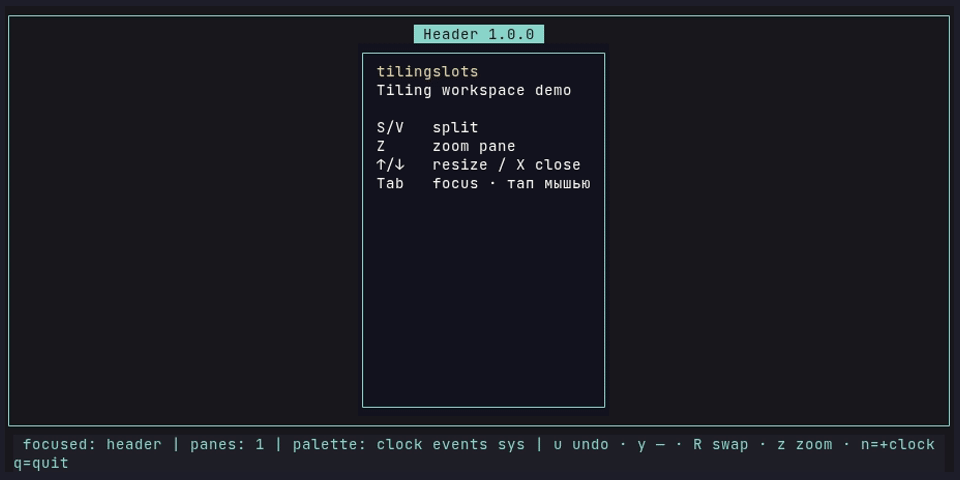

<h1 align="center">TilingSlots</h1>

<p align="center">
  
</p>

<p align="center">
  
  
  
  
  
</p>

**A terminal workspace that assembles itself from plugins.** Microkernel
tiling-slot plugin system for [nocterm](https://nocterm.dev) TUI.

nocterm draws panels (`Row`, `Column`, `Expanded`), but does not control them: each
split, resize, close, save or crash a plugin - this is manual surgery on
tree widget. `tilingslots` adds a layer where layout is data
(JSON), the panels are owned by plugins, and the assembly occurs at runtime. Falling
The plugin only drops its slot, never the application.

> **Status: pre-1.0.** Kernel feature-complete for 0.1.0; up to 1.0 API grows
> additive. Write to
> [issues](https://github.com/AmidVoshakul/tilingslots/issues).

## Write your first plugin

The plugin is a class. Declare metadata and method `build`; `setup`/`teardown`
You don’t have to write them - they are no-op by default:

```dart
import 'package:nocterm/nocterm.dart';
import 'package:tilingslots/tilingslots.dart';

class ClockPlugin extends SlotPlugin {
  const ClockPlugin({this.id = 'clock', this.slot = 'clock'});

  @override
  final String id;

  final String slot;

  @override
  String get name => 'Clock';

  @override
  String get version => '1.0.0';

  @override
  String get slotId => slot;

  @override
  Future<void> setup(ServiceContainer container, EventBus bus, PluginScope scope) async {
    // Register everything long-lived on scope: the timer will die along with the plugin.
    scope.every(const Duration(seconds: 1), (timer) {});
  }

  @override
  Component build(SlotContext context) => const Text('clock pane');
}
```

## Launch workspace

`SlotWorkspace` is a registry of plugins plus layout. Register the plugin
turn it on and it will occupy its own panel:

```dart
Future<void> main() async {
  final workspace = SlotWorkspace()..register(const ClockPlugin());
  await workspace.enable('clock');

  runApp(NoctermTilingWidget(
    layout: workspace.layout,
    focus: workspace.focus,
    slotBuilder: (slotId) => workspace.buildSlot(slotId, isFocused: false),
  ));
}
```

Get a terminal application with one panel. If the plugin crashes in `setup`,
the container will roll back, the slot will not appear, the application will continue to live.

## Build a workspace in runtime

That's why it's worth taking the package: the panels can be rearranged, changed and
reproduce **without restart**:

```dart
// (when the workspace already has the 'left'/'right' panels and the 'logs' plugin)
await workspace.enable('clock', into: 'left');     // occupy an existing empty panel
await workspace.attach('clock', 'right');          // transfer the enabled plugin
await workspace.disable('logs', keepPane: true);   // free the panel without deleting it
await workspace.spawn((slotId) => ClockPlugin(id: 'clock-$slotId', slot: slotId));
// ...and all this can be rolled back:
await workspace.undo();                            // step back
final cp = await workspace.checkpoint('clean');    // personalized snapshot
await workspace.restoreCheckpoint(cp);
```

Each mutation is written to a timeline (`workspace.timeline`), document
workspace is serialized into JSON (`toJson`/`restore`) - saving and
Desktop recovery works by itself.

## Try it on a live example

The interactive demo implements the full cycle - assembling the palette, undo/redo and
live-swap plugin implementation:

```sh
dart run example/tiling_workspace_example.dart
```

Keys: `S`/`V` — split panels, `1`/`2` — insert a plugin from the palette into
focus panel, `↑`/`↓` — resize, `X` — close, `z` — zoom panel,
`u`/`y` — undo/redo, `c` — checkpoint, `R` — replace the plugin implementation
in the live workspace, `n` is the second instance of the clock, `q` is the output with saving.

With the mouse: click on the panel - focus, drag the edge of the panel (where the neighbor is) -
resize borders. Mouse interactions use precise panel geometry
(`LayoutBuilder`) so panels don't overlap adjacent UI, e.g.
status bar.

## Graphics: cores on typed-data

We supply a package of data-kernels for live panels (monitors, graphics):
`Float32RingBuffer` (ring buffer on one `Float32List` - zero allocations
in steady state), `sparkline` (braille graph, 2x4 dots per character) and
`barGauge` (block scale with eighths). All functions are clean, accept
optional `scratch` buffer - the frame is rendered without garbage for the GC:

```dart
final ring = Float32RingBuffer(60);
final scratch = Float32List(60);

// at each tick: write the value and draw a frame in the same scratch
ring.write(cpuLoad);
final frame = sparkline(ring, width: 30, scratch: scratch);
```

## Per-pane invalidation

With `cachePanes` enabled, the panel rebuilds its contents only when it is changed
inputs (`slotVersion`) - focus, Tab and border resize do not affect the contents
neighbors (zero idle content rebuilds); the focus frame of each panel lives on its own
listener:

```dart
NoctermTilingWidget(
  controller: controller,
  slotBuilder: (slotId) => workspace.buildSlot(slotId, isFocused: false),
  cachePanes: true,
  slotVersion: (slotId) => workspace.timeline.length, // invalidation by inputs
);
```

## Architecture

```
adapter_nocterm NoctermTilingWidget TilingController SlotWorkspace
graphics Float32RingBuffer sparkline barGauge (pure Dart)
layout SplitNode/SlotNode LayoutEngine LayoutSerializer
core Plugin PluginManager ServiceContainer EventBus
```

`core` and `layout` do not import nocterm at all - they can be tested and
reuse outside terminal applications. Only tied to nocterm
`adapter_nocterm`.

## Next

- [Plugin authoring guide](doc/PLUGIN_AUTHORING.md) - contract, scoped
  effects, replace semantics, testing
- [Writing an adapter](doc/WRITING_AN_ADAPTER.md) - custom UI backend contract
- [Changelog](CHANGELOG.md) - what appeared and when
- [Comparison with cordis](doc/COMPARISON-cordis.md) - pattern mapping
  vs TypeScript meta framework
- [API reference](https://pub.dev/documentation/tilingslots/latest/) — dartdoc

## Example

Run and read [`example/tiling_workspace_example.dart`](example/tiling_workspace_example.dart) for a complete composer demo.

## 🤝 Contributing

See [CONTRIBUTING.md](CONTRIBUTING.md) for development setup, checks, and pull request
guidelines.

## ⚖️ License

Distributed under the MIT License. Includes vendored unicode-width utilities from
nocterm (MIT) - see [LICENSE](LICENSE).

---

<div align="right">

Created by [Amid Voshakul 🌠](https://github.com/AmidVoshakul)

</div>